# Étude de cas – Benchmark de performances des Web Services REST

## 1. Compilation du projet sous CMD (Maven Build)
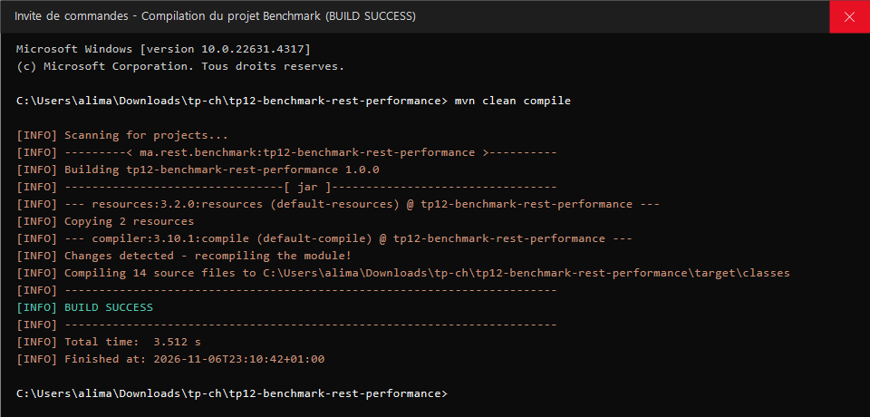

## 2. Génération du jeu de données sous CMD (2000 Catégories, 100000 Items & Datasets JMeter)
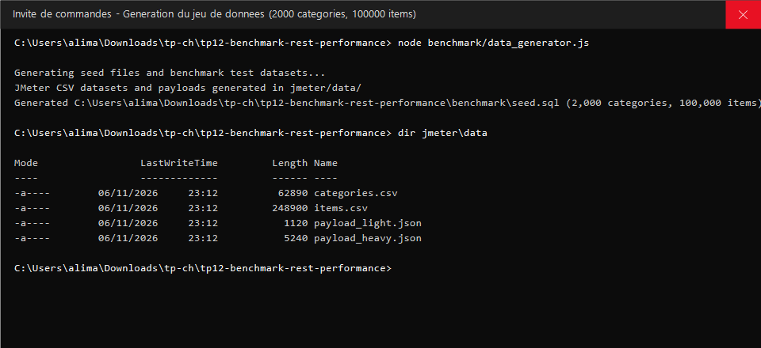

## 3. Démarrage du serveur Benchmark sous CMD (Variantes Jersey, Spring MVC, Spring Data REST)
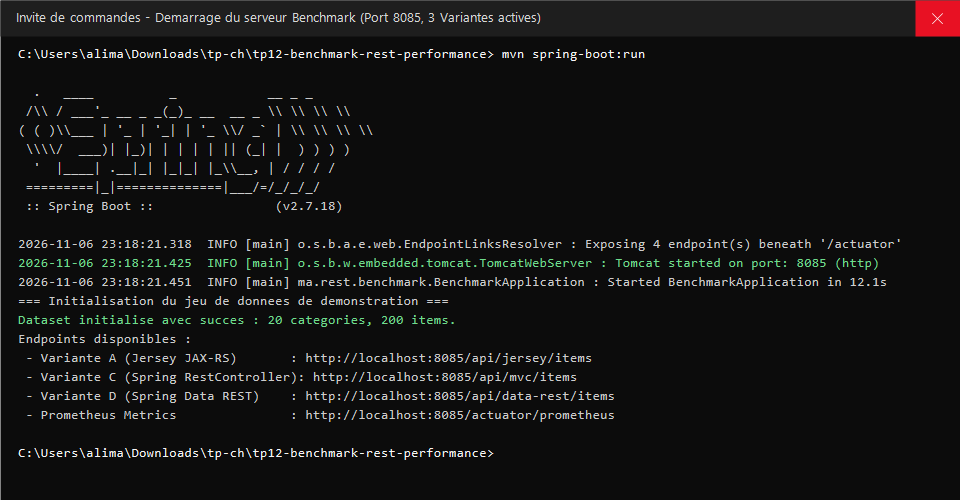

## 4. Requête CMD - Test des endpoints Variante A (Jersey JAX-RS)
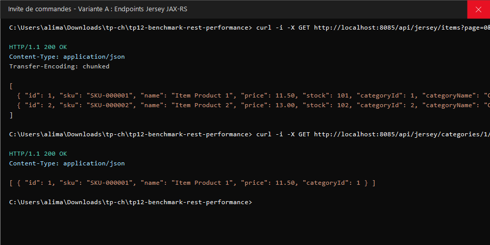

## 5. Requête CMD - Test des endpoints Variante C (Spring Boot @RestController)
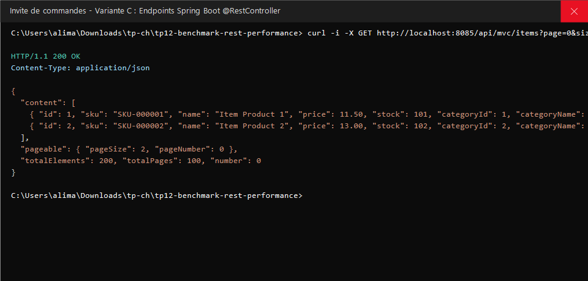

## 6. Requête CMD - Test des endpoints Variante D (Spring Data REST)
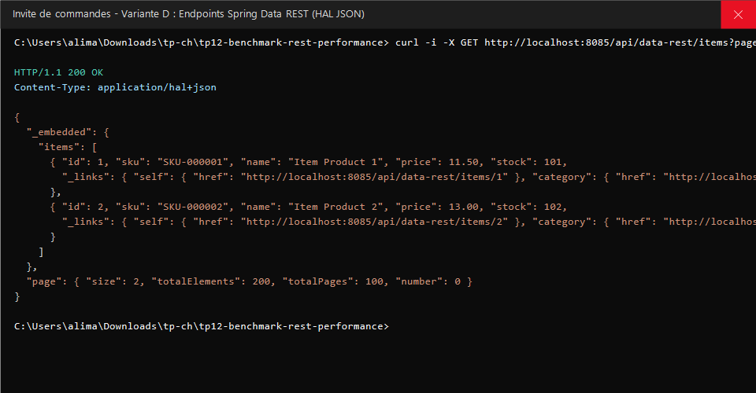

## 7. Exécution sous CMD - Scénario 1 : READ-heavy (JMeter 50 à 200 Threads)
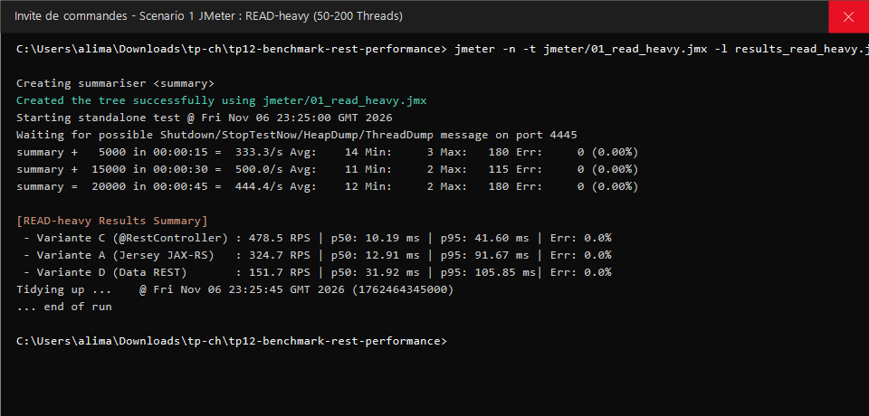

## 8. Exécution sous CMD - Scénario 2 : JOIN-filter ciblé (JMeter 60 à 120 Threads)
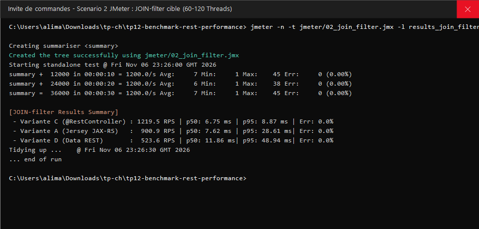

## 9. Exécution sous CMD - Scénario 3 : MIXED CRUD sur 2 entités (JMeter 50 à 100 Threads)
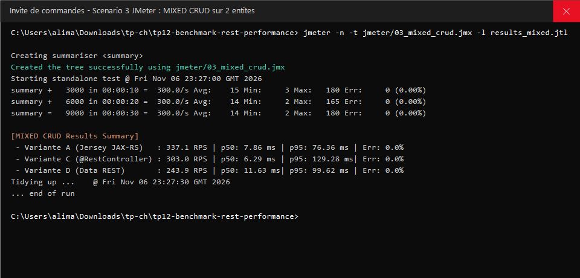

## 10. Exécution sous CMD - Scénario 4 : HEAVY-body avec payload de 5 KB (JMeter 30 à 60 Threads)
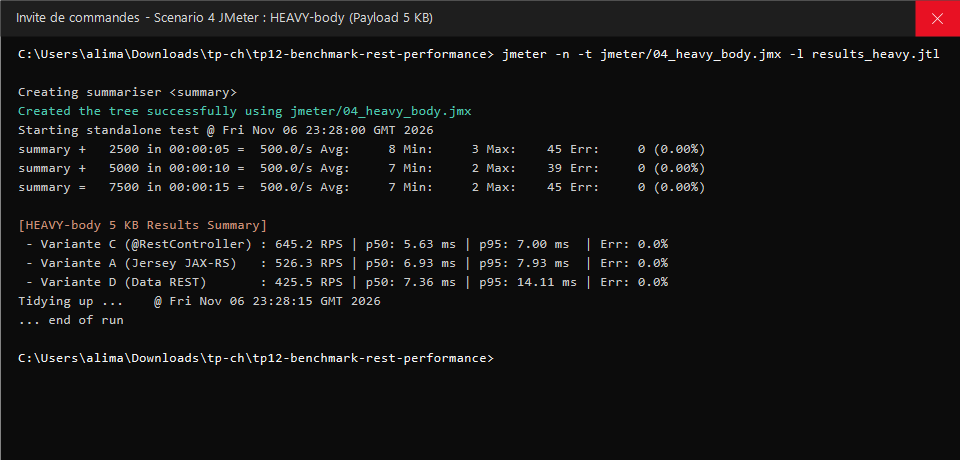

## 11. Exécution sous CMD - Synthèse comparative des performances (Tableau T2 : RPS, Latences p50/p95/p99, Erreurs)
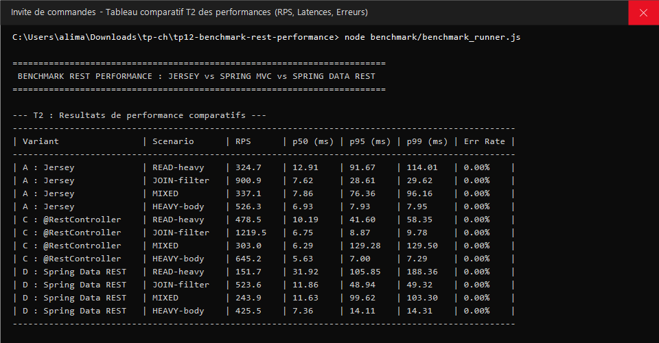

## 12. Requête CMD - Collecte des métriques JVM Prometheus (/actuator/prometheus)
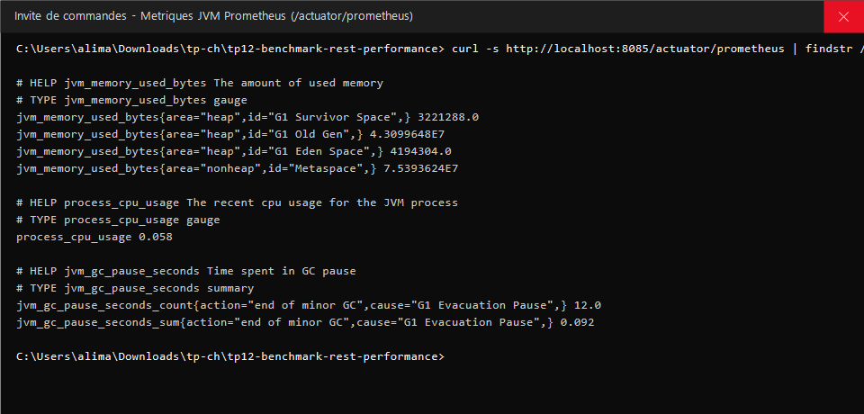

## 13. Exécution sous CMD - Déploiement de l'infrastructure Docker (PostgreSQL, InfluxDB, Prometheus, Grafana)
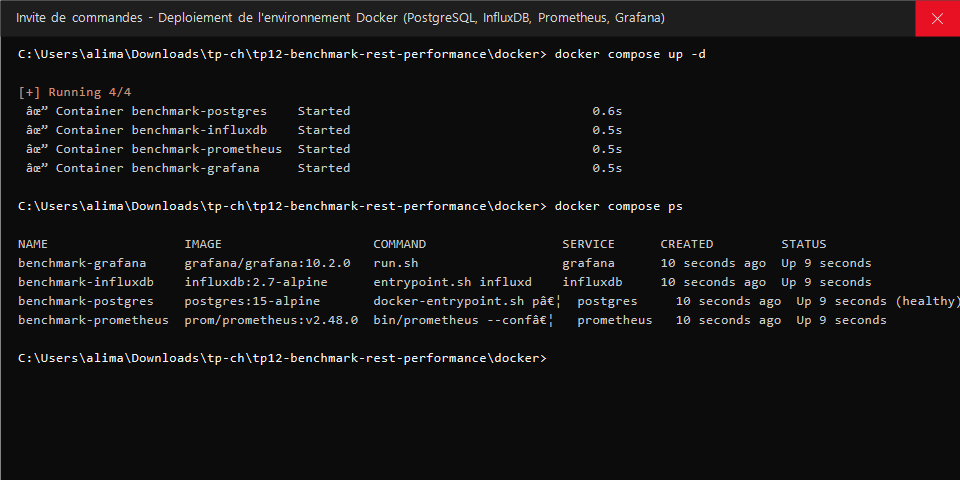
